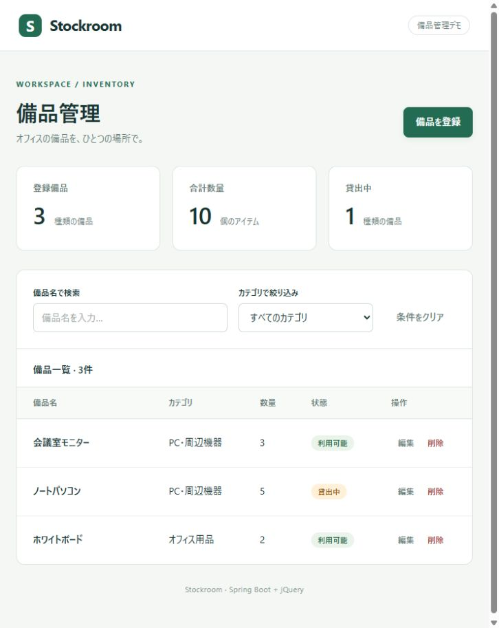

# Stockroom — 備品管理 E2E デモ

Spring Boot の REST API と、jQuery で DOM を生成する認証なしの備品管理アプリです。登録・入力チェック・検索・編集・削除を Playwright で検証できます。



## 使用技術

- Spring Boot **4.1.1** / Java **17 以上**（動作確認環境: JDK 25）
- jQuery **4.0.0 通常版**（Ajax を利用。CDN に依存せず同梱）
- Playwright **1.64.1** / Node.js **22 以上**（動作確認環境: Node.js 24）
- H2 Database / Spring JDBC / Bean Validation
- Apache Maven **3.9.11**（Wrapper 同梱、Maven の事前インストール不要）

2026-10-21 に Maven Central と npm の公開レジストリで安定版を確認して固定しています。Spring Boot の M/RC/SNAPSHOT 版は対象外です。

## 初回セットアップ

JDK と Node.js をインストールし、`JAVA_HOME` に JDK のディレクトリを設定してください。以下はプロジェクトルートで実行します。

```powershell
npm ci
npx playwright install chromium
```

初回は npm、Maven Central、Playwright のダウンロード先に接続できる環境が必要です。社内ミラーを設定している場合は、そのミラーに各パッケージが存在することを確認してください。

## アプリを起動

```powershell
npm start
```

[http://127.0.0.1:8080](http://127.0.0.1:8080) を開きます。終了は `Ctrl+C`。初回は Wrapper と Maven 依存関係の取得に時間がかかります。

通常起動では `data/equipment.mv.db` に保存されます。ページの再読み込みやアプリの再起動後もデータが残ります。空の DB で起動するとサンプル備品を3件登録します。

## E2E テスト

以下のコマンドは、すべてプロジェクトルートで実行します。

### 通常実行（ブラウザ非表示）

```powershell
npm run test:e2e
```

アプリを手動起動する必要はありません。Playwright が `e2e` プロファイルで Spring Boot を **18765 番ポート**に起動し、終了時に停止します。通常起動の 8080 番ポートとは共存できます。18765 番は空けておいてください。

### ブラウザを表示して実行

```powershell
npm run test:e2e:headed
```

Chromium のブラウザを表示しながら、全8件のテストを自動実行します。このモードでも Spring Boot は自動起動します。操作は自動で進み、テスト終了時にブラウザは閉じます。

### UI モードでテスト結果や操作履歴を確認

```powershell
npm run test:e2e:ui
```

Playwright の UI が開きます。左側の一覧からテストを選び、実行ボタンで開始してください。実行後は各操作のスナップショットやログを確認できます。終了するときはターミナルで `Ctrl+C` を押します。

### デバッガーで1操作ずつ実行

```powershell
# ブラウザと Playwright Inspector を表示して全テストを実行
npm run test:e2e -- --debug

# 登録 → 検索 → 編集 → 削除のシナリオだけを実行
npm run test:e2e -- --debug --grep "登録 →"
```

Playwright Inspector の「Step over」で操作を1つずつ進め、「Resume」で実行を再開できます。画面の変化をゆっくり確認したい場合や、失敗箇所を調べたい場合に利用してください。

`--` より後ろの引数は Playwright に渡されます。`--grep` はテスト名に一致するものだけを実行するオプションで、ブラウザ表示モードにも付けられます。

```powershell
npm run test:e2e:headed -- --grep "登録 →"
```

### ステップごとのスクリーンショットと HTML レポート

画面テストは `test.step()` で操作と検証を区切り、各ステップの検証成功後にページ全体の PNG を撮影します。`step.attach()` でステップに添付するため、成功したテストの画面も HTML レポートに残ります。撮影はブラウザ非表示・表示ありのどちらでも行います。

```powershell
# テストを実行してレポートと画像を生成
npm run test:e2e

# HTML レポートを開く
npm run test:report
```

レポートでテスト名を選び、「Test Steps」のステップを展開すると、そのステップに添付された画像を開けます。初期一覧の画像は「Before Hooks」内の「初期一覧を表示」にあります。

メインのデモシナリオでは、次の12場面を記録します。

1. 初期一覧
2. 登録フォーム入力後
3. 登録後の一覧
4. 登録した備品の検索結果
5. 編集フォーム入力後
6. 更新後の一覧
7. 再読み込み後の保存確認
8. 削除確認ダイアログ
9. 削除キャンセル後
10. 削除後の一覧
11. 削除した備品の検索結果（該当なし）
12. 再読み込み後の削除確認

ほかの画面テストでも、未入力・不正数量のエラー、取得失敗からの復旧、保存失敗時の入力保持と再送などを記録します。API のステータスコードだけを確認するステップには画像を添付しません（共通の初期一覧表示は記録します）。

共通処理は `tests/e2e/helpers/screenshot-step.js` にあります。新しい画面ステップを追加するときは、操作と `expect` を `screenshotStep()` のコールバック内に書きます。

```javascript
await screenshotStep(page, '備品名で検索', async () => {
  await page.getByLabel('備品名で検索').fill('モニター');
  await expect(page.getByRole('row')).toHaveCount(2);
});
```

画像はテスト実行ごとに生成され、HTML レポートは `playwright-report/` に保存されます。レポートを共有するときは、画像を含むフォルダ全体を渡してください。これらの生成物は Git の対象外です。

### 失敗時の記録

```powershell
npm run test:report
```

ステップの操作や検証が失敗した場合、成功時のステップ画像は作成されません。代わりに、既存の `screenshot: 'only-on-failure'` による失敗時画像がテストに添付されます。`test-results/` には失敗時のスクリーンショット・動画・トレースが残り、HTML レポートから確認できます。

```powershell
# トレースを直接開く場合（実際のパスに置換）
npx playwright show-trace test-results/<テスト名>/trace.zip
```

### 3種類のブラウザで実行

```powershell
npx playwright install chromium firefox webkit
npm run test:e2e:all
```

Chromium・Firefox・WebKit で同じテストを実行します。Firefox のこの環境での起動制約は「実行確認結果」を参照してください。

## GitHub Actions で E2E を自動実行

[Playwright E2E ワークフロー](https://github.com/mikoto2000/spring-boot-jquery-playwright-demo/actions/workflows/e2e.yml) は `.github/workflows/e2e.yml` に定義しています。

次のタイミングで実行します。

- `main` ブランチへの push
- `main` ブランチを対象とする Pull Request の作成・更新
- Actions 画面からの手動実行（`Run workflow`）

Ubuntu 24.04 / Temurin JDK 25 / Node.js 24 で依存関係とブラウザをインストールし、Spring Boot をビルドした後に `npm run test:e2e:all` を実行します。Chromium・Firefox・WebKit で各8件、計24件を検証します。Spring Boot のテスト用サーバーは Playwright が自動起動・停止します。追加の Secrets 設定は不要です。

CI では既存設定により、テストを1ワーカーで実行し、失敗時は1回リトライします。同じブランチの新しい実行が始まると、古い実行はキャンセルします。

### スクリーンショット付きレポートをダウンロード

1. GitHub リポジトリの **Actions → Playwright E2E** を開く。
2. 確認したい実行を選び、ジョブが終了するまで待つ。
3. 実行の概要画面の **Artifacts** から **playwright-report** をダウンロードする（GitHub へのログインが必要）。
4. ZIP を展開し、`index.html` と `data/` が入ったフォルダを確認する。
5. このプロジェクトのルートから、次のコマンドで展開先を指定する。

```powershell
# 初回のみ、プロジェクトの依存関係を準備
npm ci

# パスは ZIP の展開先に置き換える（既存のローカルレポートとは別の場所を推奨）
npx playwright show-report "C:\Downloads\playwright-report"
```

macOS / Linux でも、展開先のパスを指定して同じコマンドで開けます。ダウンロードしたレポートの閲覧に Spring Boot の起動やテストの再実行は不要です。

HTML レポートでテストを選ぶと、各ステップのスクリーンショットを確認できます。画像を参照するため、`index.html` と `data/` を一緒に保管してください。

レポートはテスト成功時・失敗時ともにアップロードし、**14日間**保存します。失敗時は途中まで成功したステップの画像と、失敗時画像・動画・トレースもレポートから確認できます。依存関係のインストールやビルドの失敗でテストを開始できなかった場合はレポートが生成されないため、ジョブログを確認してください。キャンセルされた実行のアップロードはスキップします。

### 手動実行

**Actions → Playwright E2E → Run workflow** でブランチを選び、実行できます。GitHub CLI を使う場合は次のコマンドでも実行できます。

```powershell
gh workflow run e2e.yml --ref main
gh run list --workflow e2e.yml

# 実行 ID は上の一覧から選ぶ
gh run download <実行ID> --name playwright-report --dir ./downloaded-report
npx playwright show-report ./downloaded-report
```

## 検証する振る舞い

1. 初期一覧、名前検索、カテゴリ絞り込み、該当なし、検索条件クリア
2. 未入力・負数・小数・上限超過・数量未入力のエラーと未登録
3. 登録 → 検索 → 数量・状態の編集 → 再読み込みで保存確認 → 削除キャンセル → 削除 → 該当なし
4. 編集キャンセルと数量ゼロの登録
5. 一覧取得失敗と再試行
6. 保存失敗時の入力保持と再送
7. HTML を含む備品名を文字列として表示
8. API 側の入力検証と存在しない ID の404

成功系は実際の Spring Boot API と H2 に接続します。障害系2件だけ Playwright の `page.route()` で HTTP エラーを再現します。固定時間の sleep は使わず、画面の期待状態を `expect` で待ちます。

## テストデータと構成

- 通常: ファイル DB。認証なし、ループバックで待ち受けます。
- E2E: 別のインメモリ DB。各テスト前に `POST /api/test/reset` でサンプル3件に戻します。この API は `e2e` プロファイル限定です。
- DB を共有しているため `workers: 1` に固定しています。各テストは実行順に依存せず、単独実行できます。
- `index.html` は `#app` とアセット読み込みのみ。画面要素は `app.js` の jQuery で生成します。
- 利用者の入力は `.text()` / `.val()` で扱います。
- 登録・更新・削除は Ajax → REST API → JDBC → H2 の順に処理します。

```text
src/main/java/com/example/equipment/   API・DB・初期データ・E2E専用リセット
src/main/resources/static/            HTML・jQuery DOM構築・CSS・jQuery本体
tests/e2e/equipment.spec.js            画面の受け入れテストとAPI検証
tests/e2e/helpers/screenshot-step.js   検証後の画面撮影とステップへの添付
playwright.config.js                  起動・ブラウザ・レポート設定
scripts/                             OS共通起動とjQueryコピー
```

## TDD の進め方

t_wada さんの TDD で重視される Red → Green → Refactor のサイクルで、観測可能な振る舞いをテストにします。初期コミットは起動/API の土台と、画面実装前の受け入れテストです。

機能を追加するときは、まず1つの小さい期待をテストに書き、そのテストが意図した理由で失敗することを確認します。その後、その期待を満たす実装を加えます。成功したら重複を整理し、テストを再実行します。

```powershell
# 1ケースだけ実行して Red / Green を確認
npm run test:e2e -- --grep '初期データ'

# 変更後に全ケースを実行
npm run test:e2e
```

## JAR で実行

```powershell
npm ci
.\mvnw.cmd package
java -jar target/equipment-demo-1.0.0.jar
```

macOS / Linux は Maven コマンドを `sh ./mvnw package` に置き換えてください。`npm start` と Playwright の npm コマンドは共通です。`mvnw package` 単体では E2E は実行されません。

## 実行確認結果

2026-10-21、Windows / JDK 25 / Node.js 24 で確認しました。

| 検証 | 結果 |
| --- | --- |
| Chromium | 8 / 8 成功 |
| WebKit | 8 / 8 成功 |
| Firefox | ブラウザ起動前に環境エラー。機能検証は未完了 |
| 通常起動のトップページ | HTTP 200・目視確認済み |
| 通常起動のテスト専用リセット API | HTTP 404 |

ステップ画像の追加後も Chromium・WebKit の計16テストが成功しました。1ブラウザあたり40枚、合計80枚の PNG がステップに添付されていることを確認し、HTML レポートでの画像表示も目視確認しています。

Firefox は Playwright から `spawn UNKNOWN`、実行ファイルの直接起動でも Windows の「サイド バイ サイド構成が正しくない」エラーになりました。OS のランタイム環境を修復した後に `npx playwright test --project=firefox` で再検証してください。ブラウザ起動を含む `test:e2e:all` は、この環境では終了コード1になります。通常の `test:e2e` は Chromium のみを実行します。

開発中に確認した Red → Green → Refactor の記録は [docs/tdd.md](docs/tdd.md) にあります。

## 公式情報

- [Spring Boot](https://spring.io/projects/spring-boot/)
- [jQuery のダウンロード](https://jquery.com/download/)
- [Playwright の Web Server 設定](https://playwright.dev/docs/test-webserver)

jQuery は MIT ライセンスです。ライセンスは `THIRD-PARTY-NOTICES.txt` を参照してください。Maven Wrapper は Apache License 2.0 です（スクリプト内に表記）。
